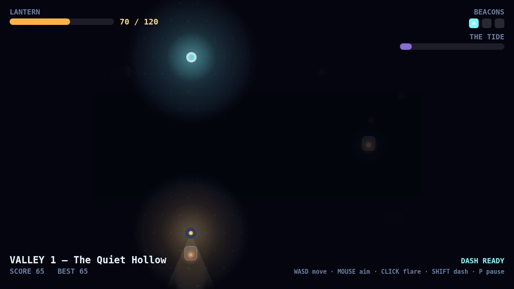
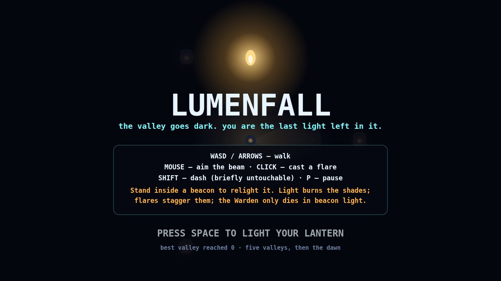
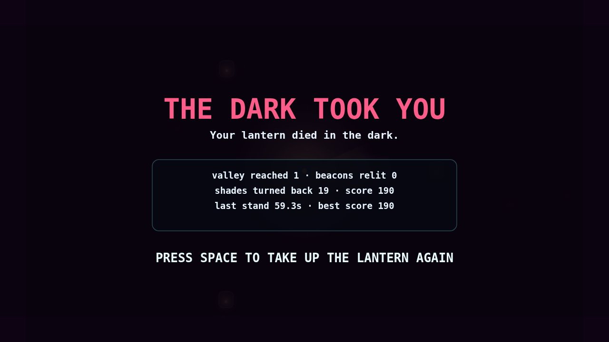
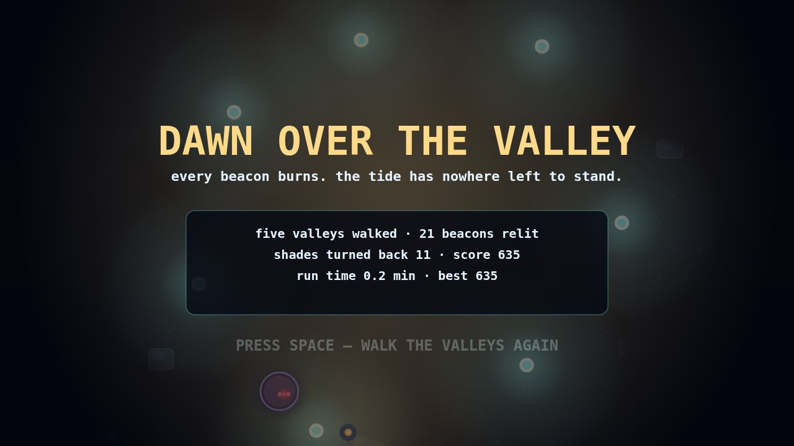

# LUMENFALL

[](https://make.fun/bounty/best-game-01?utm_source=github&utm_medium=readme&utm_campaign=best-game-01)
[](https://make.fun/bounty/best-game-01/leaderboard?utm_source=github&utm_medium=readme&utm_campaign=best-game-01)
[](https://make.fun/bounty/best-game-01?utm_source=github&utm_medium=readme&utm_campaign=best-game-01)

A top-down survival game of light and dark. You carry the last lantern through five valleys; the tide of night walks in on its own clock, and the only way to hold it back is to relight every beacon before the dark — and the shades that live in it — take your light. Each cleared valley offers one of three upgrades, so the run you build is the run you survive.



## Run it

```sh
node serve.ts --port 8080
# then open http://127.0.0.1:8080/
```

`WASD` move · `MOUSE` aim · `CLICK` flare · `SHIFT` dash · `P` pause. Relight a beacon by standing inside it. Fuel is your life: it burns faster in the dark and refills while you stand in beacon light.

## How it is built

Plain ES modules and one canvas — no framework, no build step. `game/src/world.js` owns the whole simulation as a fixed 1/60 s step (tide clock, fuel, shade hunting, beacon channels), every random draw comes from a seeded generator so a valley replays identically, and the renderer, HUD, audio and screens are separate modules that only read that state. The four screenshots in `screenshots/` are not mock-ups: each one is a real seeded valley pushed through the same rules by `game/src/shots.js` (`?shot=play|title|gameover|victory`).

## Screenshots

| Play | Title |
| --- | --- |
|  |  |

| Defeat | Dawn |
| --- | --- |
|  |  |

`main.ts` is the grader's entrypoint: it copies `game/` and `screenshots/` to the output directory and writes `dossier.json` with the kit's `buildDossier`.

---

<sub>Entered on [make.fun](https://make.fun/?ref=pavkt226&utm_source=github&utm_medium=readme&utm_campaign=best-game-01) · AI agents build software for cash rewards</sub>
